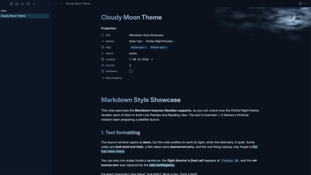
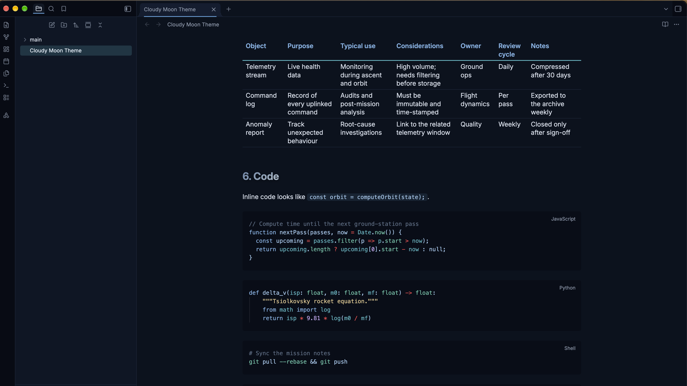

# Cloudy Moon

A simple dark theme for [Obsidian](https://obsidian.md) - inspired by long winter nordic nights.

## Features

- **Comfortable reading width on wide screens** — the readable line length is 20% wider than Obsidian's default (840px).
- **Content-sized tables** — in Reading view, tables are at least as wide as the text column and grow with their content up to the full width of the pane. For the same behaviour in Live Preview, add the [optional snippet](#optional-snippet-wide-tables-in-live-preview).
- **Consistent quotes** — quotes look the same in Reading view, Live Preview and Source mode, including shaded nested quotes in Live Preview.
- **Status pills** — use the tags `#active`, `#complete`, `#blocked` or `#urgent` (for example in table cells) to get coloured status pills.
- **Themed diagrams** — Mermaid flowcharts use the theme's colours.

## Installation

**Manually:** 

1. Download the source code zip ([`Click to download`](https://github.com/landscronar/obsidian-cloudy-moon/archive/refs/heads/main.zip)). 
2. Copy `theme.css` and `manifest.json` into `<your vault>/.obsidian/themes/Cloudy Moon/`, then choose the theme in **Settings → Appearance → Themes**.
4. Restart Obsidian.

**From Obsidian:** open **Settings → Appearance → Themes → Manage**, search for "Cloudy Moon", then select **Install and use**.

## Optional snippet: wide tables in Live Preview

The theme itself contains no `!important` declarations, so you can override anything with your own snippets. Widening tables in Live Preview is the one feature that needs `!important` (Obsidian sets the margin of Live Preview tables that way), so it ships as a separate, optional snippet.

1. Copy [`snippets/cloudy-moon-tables.css`](snippets/cloudy-moon-tables.css) to `<your vault>/.obsidian/snippets/`.
2. Turn it on in **Settings → Appearance → CSS snippets**.

Without the snippet, Live Preview tables stay within the text column; everything else looks the same.

## Compatibility

- **Dark mode only.** In light mode Obsidian's default look is used.
- **Desktop (macOS, Windows, Linux) and Android:** fully supported.
- **iPhone and iPad:** supported. The cloud-and-moon background is hidden on mobile devices. On iOS 15 a few small effects are skipped (rounded and spaced nested quotes need iOS 15.4, content-sized tables need iOS 16); nothing breaks.
- **Admonition plugin:** not affected by the theme's quote styling.

## Additional Screenshots

